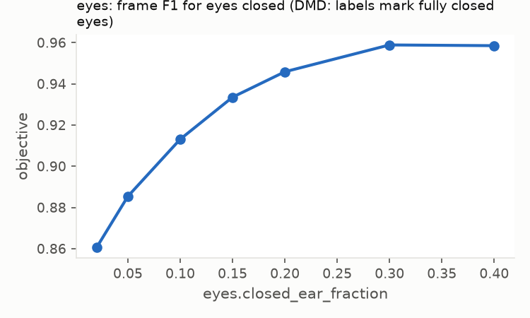
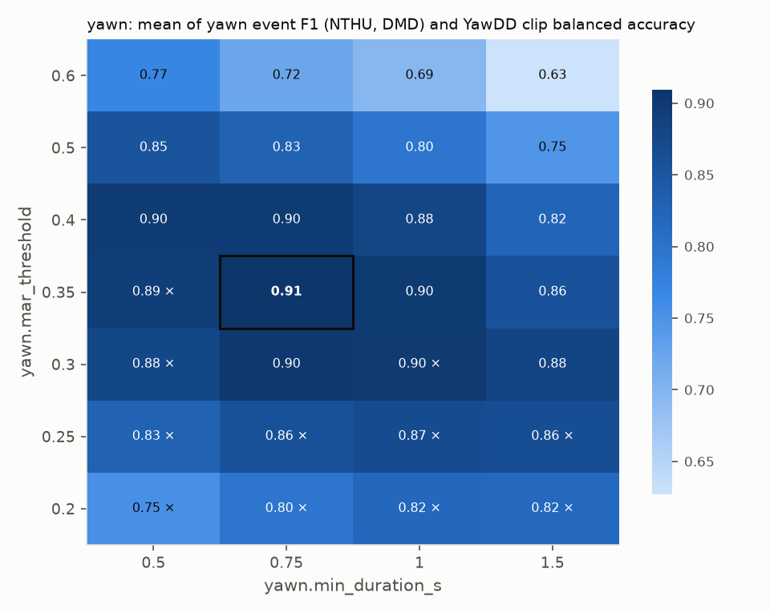
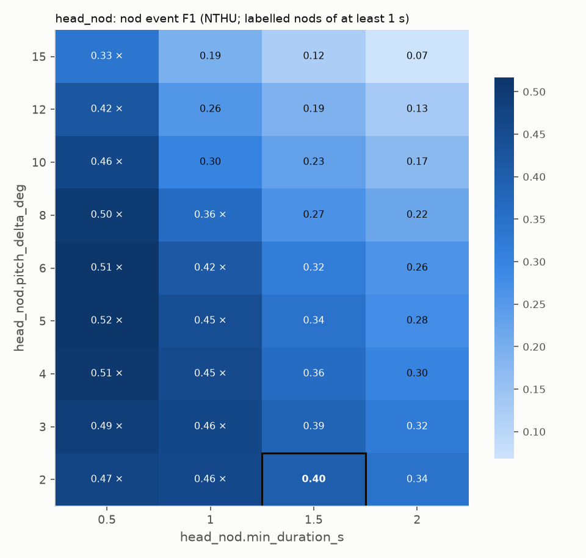
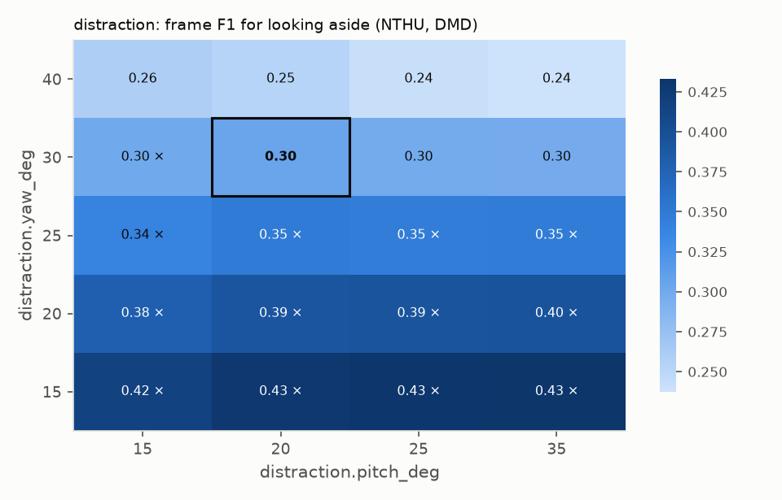
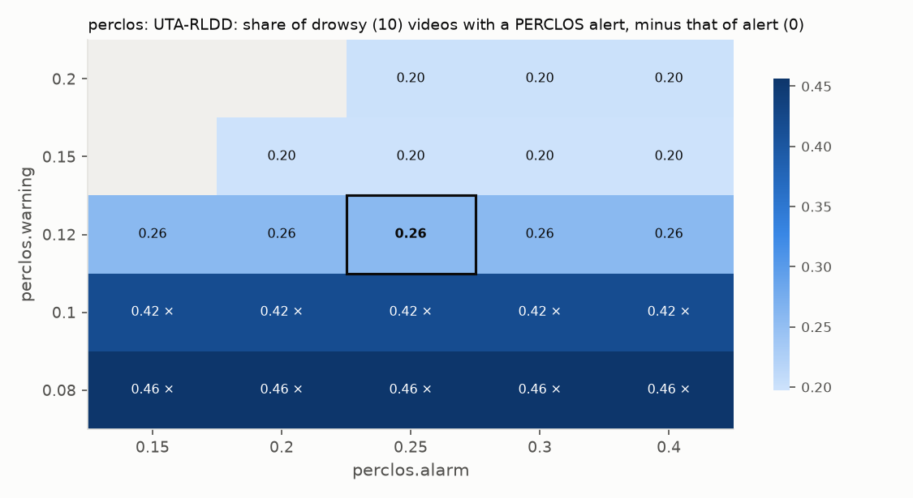
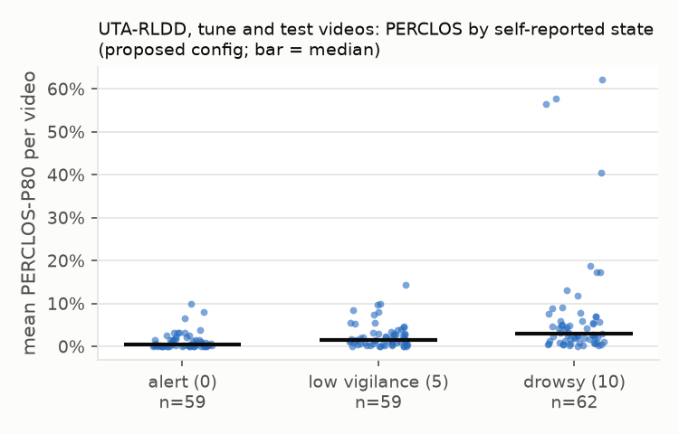

# Milestone 5 evaluation

Generated by `python -m eval.report` from `eval/reports/tuning.json`. Every number comes
from replaying extracted features through the real `DriverMonitor`. Frames before
calibration ends are not scored. Splits are by subject: see `eval/catalog.py`.

## Proposed threshold changes (not applied)

- `distraction.pitch_deg`: 25 → **20**
- `eyes.closed_ear_fraction`: 0.15 → **0.2**
- `head_nod.min_duration_s`: 1 → **1.5**
- `head_nod.pitch_delta_deg`: 15 → **2**
- `perclos.warning`: 0.15 → **0.12**
- `yawn.mar_threshold`: 0.6 → **0.35**
- `yawn.min_duration_s`: 1 → **0.75**

These values came from a grid search on the **tune** split (`python -m eval.tune`). A
point was eligible only if two alert rates stayed within 1 per hour of the
original defaults, both measured on the same 308 non-drowsy and calm tune
clips:
- drowsiness alert episodes, defaults 2.05/h;
- distraction alert episodes, defaults 4.59/h.

For eye closure, long-closure recall also had to stay within 0.02 of its starting
value. `src/drowsiness/default_config.yaml` is unchanged until a person accepts them.
Head-nod values have no held-out check: NTHU-DDD's testing set has no nod labels.

> **Warning:** on the test split the proposal raises drowsiness alert episodes from 2.08/h to 4.76/h, more than the 1/h tuning allows. See the per-change table below before accepting it.
>
> **Warning:** `head_nod.pitch_delta_deg` = 2 is at the edge of the values tried (2–15) in group head_nod.

## Alert rates on the test split, one change at a time

Same rule as in tuning, checked on the held-out non-drowsy and calm clips. Each
"only" row applies one proposed change to the defaults. These are few hours of video,
so a handful of episodes moves the rate a lot.

Test split: 3.4 h non-drowsy, 2.4 h calm.

| Config | Drowsiness alerts/h | Distraction alerts/h |
|---|---:|---:|
| default | 2.08 | 12.61 |
| proposed | 4.76 | 12.61 |
| default + `distraction.pitch_deg` only | 2.08 | 12.61 |
| default + `eyes.closed_ear_fraction` only | 2.68 | 12.61 |
| default + `head_nod.min_duration_s` only | 2.08 | 12.61 |
| default + `head_nod.pitch_delta_deg` only | 2.98 | 12.61 |
| default + `perclos.warning` only | 2.98 | 12.61 |
| default + `yawn.mar_threshold` only | 2.68 | 12.61 |
| default + `yawn.min_duration_s` only | 2.08 | 12.61 |

## Headline results

| Metric | Test: default | Test: proposed | Tune: default | Tune: proposed |
|---|---:|---:|---:|---:|
| Eyes closed, frame F1 (DMD) | 0.76 | 0.80 | 0.93 | 0.95 |
| Long closure caught (≥ microsleep_s, DMD) | 26% | 39% | 71% | 80% |
| Yawn events: recall | 38% | 48% | 47% | 87% |
| Yawn events: precision | 100% | 100% | 98% | 94% |
| YawDD clips: yawning clips with a yawn | 59% | 87% | 52% | 87% |
| YawDD clips: other clips with a yawn | 0% | 4% | 0% | 4% |
| Head nod events: F1 (NTHU) | – | – | 0.13 | 0.40 |
| Looking aside, frame F1 | 0.41 | 0.43 | 0.30 | 0.30 |
| Long look-aside caught (≥ long_s) | 37% | 37% | 13% | 14% |
| NTHU drowsy frames, F1 | 0.64 | 0.64 | 0.49 | 0.61 |
| UTA PERCLOS AUC, drowsy vs alert | 0.79 | 0.80 | 0.79 | 0.80 |
| UTA drowsy videos with a PERCLOS alert | 17% | 25% | 22% | 30% |
| UTA alert videos with a PERCLOS alert | 0% | 0% | 4% | 4% |
| Drowsiness alert episodes/h, non-drowsy clips | 2.08 | 4.76 | 2.05 | 2.93 |
| Distraction alert episodes/h, calm clips | 12.61 | 12.61 | 4.59 | 5.04 |

"–" means the split has no labels for that metric. For example, NTHU-DDD's testing set only
has drowsiness labels, and nod labels exist only in its training set.

## Tuning

| Group | Objective (tune split) | Clips | Start | Proposed | Score | Drowsiness alerts/h | Distraction alerts/h |
|---|---|---:|---|---|---|---|---|
| eyes | frame F1 for eyes closed (DMD: labels mark fully closed eyes) | 319 | `eyes.closed_ear_fraction` 0.15 | `eyes.closed_ear_fraction` 0.2 | 0.93 → 0.95 | 2.05 → 2.86 | 4.59 → 4.48 |
| yawn | mean of yawn event F1 (NTHU, DMD) and YawDD clip balanced accuracy | 704 | `yawn.mar_threshold` 0.6, `yawn.min_duration_s` 1 | `yawn.mar_threshold` 0.35, `yawn.min_duration_s` 0.75 | 0.69 → 0.91 | 2.86 → 2.86 | 4.48 → 4.48 |
| head_nod | nod event F1 (NTHU; labelled nods of at least 1 s) | 595 | `head_nod.pitch_delta_deg` 15, `head_nod.min_duration_s` 1 | `head_nod.pitch_delta_deg` 2, `head_nod.min_duration_s` 1.5 | 0.19 → 0.40 | 2.86 → 2.34 | 4.48 → 4.48 |
| distraction | frame F1 for looking aside (NTHU, DMD) | 606 | `distraction.yaw_deg` 30, `distraction.pitch_deg` 25 | `distraction.yaw_deg` 30, `distraction.pitch_deg` 20 | 0.30 → 0.30 | 2.34 → 2.34 | 4.48 → 5.04 |
| perclos | UTA-RLDD: share of drowsy (10) videos with a PERCLOS alert, minus that of alert (0) | 405 | `perclos.warning` 0.15, `perclos.alarm` 0.25 | `perclos.warning` 0.12, `perclos.alarm` 0.25 | 0.20 → 0.26 | 2.34 → 2.93 | 5.04 → 5.04 |

Cells marked × were not eligible: an alert rate went over its cap, or a guarded
metric got worse. The outlined cell is the proposal.

## By condition (test split, proposed config)

**NTHU-DDD** (active-IR video; `night*` clips are 15 fps)

| Condition | Clips | Drowsy frames F1 | False alarms/h |
|---|---:|---:|---:|
| glasses | 14 | 0.65 | – |
| nightglasses | 14 | 0.62 | – |
| nightnoglasses | 14 | 0.71 | – |
| noglasses | 14 | 0.68 | – |
| sunglasses | 14 | 0.50 | – |

**DMD** (session group)

| Condition | Clips | Eyes closed F1 | Yawn recall | Look-aside F1 |
|---|---:|---:|---:|---:|
| gA | 4 | 0.97 | 50% | 0.30 |
| gB | 4 | 0.99 | 50% | 0.60 |
| gC | 4 | 0.93 | 25% | 0.35 |
| gE | 4 | 0.27 | 50% | 0.45 |
| gZ | 4 | 0.87 | 60% | 0.44 |

**YawDD** (camera position and eyewear)

| Condition | Clips | Yawning clips with a yawn | Other clips with a yawn |
|---|---:|---:|---:|
| dash_glasses | 5 | 100% | – |
| dash_noglasses | 5 | 80% | – |
| mirror_glasses | 30 | 80% | 0% |
| mirror_glassesmoustache | 6 | 50% | 0% |
| mirror_noglasses | 54 | 95% | 6% |
| mirror_sunglasses | 13 | 80% | 12% |

## Data coverage

| Dataset | Split | Clips | Hours | Face found | Calibration fallback | Never calibrated | Cut short |
|---|---|---:|---:|---:|---:|---:|---:|
| DMD | test | 20 | 1.3 | 98% | 0 | 0 | 0 |
| DMD | tune | 45 | 3.0 | 97% | 0 | 0 | 0 |
| NTHU-DDD | test | 70 | 6.8 | 96% | 5 | 0 | 0 |
| NTHU-DDD | tune | 376 | 9.9 | 91% | 12 | 0 | 0 |
| UTA-RLDD | test | 36 | 6.0 | 100% | 0 | 0 | 0 |
| UTA-RLDD | tune | 144 | 25.2 | 99% | 1 | 0 | 0 |
| YawDD | test | 113 | 0.9 | 99% | 0 | 0 | 0 |
| YawDD | tune | 236 | 1.8 | 99% | 0 | 1 | 0 |
